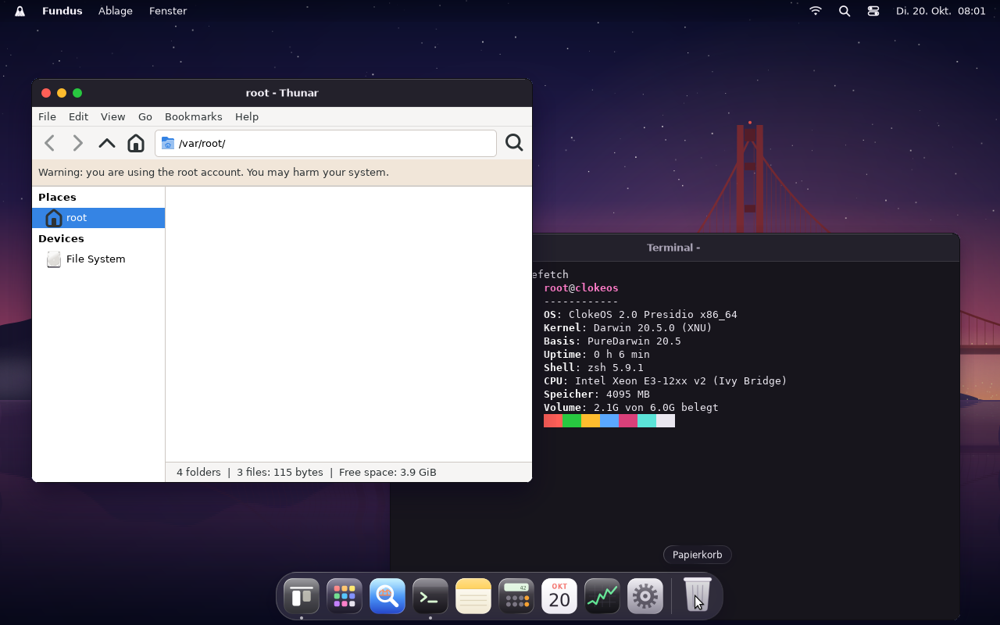
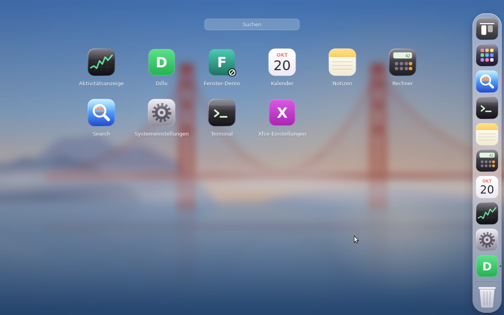
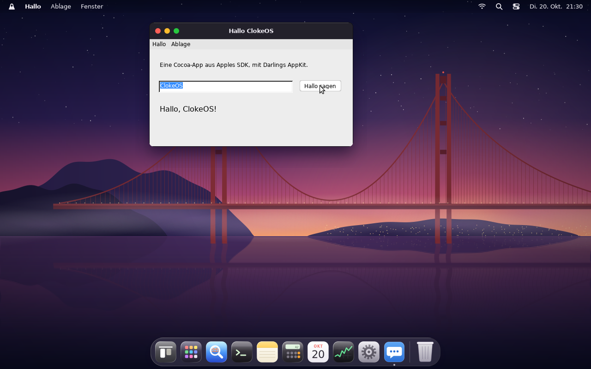
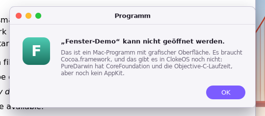
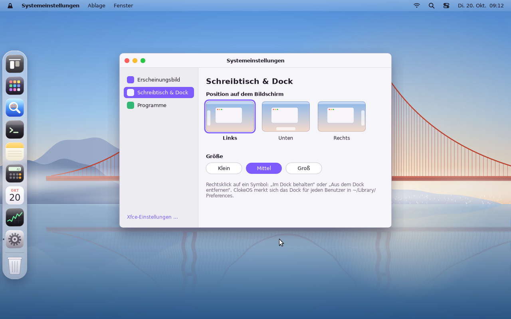

# ClokeOS

Ein macOS-ähnliches Betriebssystem auf Basis des Darwin-Kernels (XNU), mit einem Umhang als Logo.

## Was es schon gibt

`clokeos.html` ist der Prototyp der Benutzeroberfläche. Er läuft in jedem Browser:

- Startbildschirm mit Umhang-Logo (Taste **V** zeigt den ausführlichen XNU-Bootlog), Anmeldefenster
- Menüleiste mit ClokeOS-Menü, App-Menüs, WLAN, Batterie, Kontrollzentrum und Uhr
- Dock mit Vergrößerung, Laufindikatoren und Papierkorb; Fenster lassen sich ziehen, vergrößern, minimieren und zoomen
- Liquid-Glass-Design im Stil von macOS Golden Gate: durchscheinende Fenster, Dock mit Lichtbrechung (in Chromium-Browsern), Glasmenüs, Regler „Liquid Glass“ von klar bis getönt
- Hintergrundbild „Goldenes Tor“: eine selbst gezeichnete Hängebrücke im Nebel, hell am Tag und dunkel am Abend
- Apps: Fundus (Dateimanager; im Theater ist der Fundus der Raum, in dem Kostüme und Umhänge hängen), Search (Browser mit Tabs, Verlauf und Suche über ClokeOS-Seiten und eigene Dateien; fremde Webseiten öffnen in einem neuen Tab, weil ClokeOS selbst im Browser läuft), Terminal (zsh-ähnlich: `ls`, `cd`, `cat`, `uname -a`, `sw_vers`, `sysctl`, `launchctl list`, `clokefetch` …), Notizen, Rechner, Kalender, Aktivitätsanzeige, Systemeinstellungen
- Suche (Strg + Leertaste), Programme-Übersicht (F4), Hell-/Dunkelmodus, Akzentfarben, fünf Hintergrundbilder
- Ein virtuelles Dateisystem mit Darwin-Struktur (`/System`, `/Users`, `/Applications`, `/bin` …), das im Browser gespeichert bleibt

Lokal starten:

```bash
python -m http.server 8765
```

Danach `http://localhost:8765/clokeos.html` öffnen.

## Echtes ClokeOS auf XNU

Im Ordner `clokeos-darwin/` entsteht das echte System. Es bootet in einer VM einen echten Darwin-Kernel (XNU, Darwin 20.5.0) bis zur zsh und meldet sich dort als ClokeOS. In der Desktop-Variante startet danach CloakServer, der Fensterserver von ClokeOS, mit Menüleiste, Dock und Fenstern im Stil der Oberfläche (siehe [Desktop: CloakServer](#desktop-cloakserver)).

```text
root@clokeos / # sw_vers
ProductName:		ClokeOS
ProductVersion:		2.0
BuildVersion:		2A17
root@clokeos / # uname -a
Darwin clokeos 20.5.0 Darwin Kernel Version 20.5.0: Sun Aug 23 10:54:37 UTC 2026; nixbld:xnu-build/RELEASE_X86_64 x86_64
```


Grundlage ist das fertige Image von [PureDarwin 20.5](https://github.com/PureDarwin/PureDarwin/releases/tag/20.5) (UEFI, eigener Loader, XNU, launchd, zsh, ext4 als Wurzeldateisystem). ClokeOS ändert daran:

- `SystemVersion.plist`: ClokeOS 2.0 „Presidio“, Build 2A17 (launchd setzt daraus auch `kern.osversion`)
- `sw_vers` liest die Plist wie bei macOS; PureDarwins eigenes `sw_vers` hat „PureDarwin 11.3“ fest einkompiliert
- Rechnername `clokeos` über den launchd-Dienst `com.clokeos.hostname`
- Anmeldetext mit Umhang (`/etc/motd`), Eingabeaufforderung `root@clokeos / #`
- `clokefetch` wie im Terminal der Oberfläche, Volume-Name „Cloke HD“
- Bootlogo: der Umhang aus der Oberfläche statt des Kernel-Logs (eigener Build von PureDarwins Loader, siehe unten); V beim Start gedrückt halten zeigt das Log
- Desktop-Variante: CloakServer auf Xorg, gestartet von launchd

Einmal einrichten (Homebrew):

```bash
brew install qemu e2fsprogs mtools mingw-w64
```

Image bauen und starten:

```bash
cd clokeos-darwin && ./brand.sh && ./run.sh
```

`brand.sh` lädt das PureDarwin-Image (275 MB) und die Quellen des Bootloaders (zusammen 300 KB, alle Prüfsummen werden geprüft), baut den Loader mit Bootlogo, schreibt die Dateien aus `overlay/` mit `debugfs` ins ext4-Dateisystem (ohne Linux und ohne Root-Rechte), legt Loader und Boot-Argumente mit `mtools` in die EFI-Partition und erzeugt `~/ClokeOS-work/out/clokeos-2.0-x86_64.img`. `run.sh` öffnet ein QEMU-Fenster mit dem Bildschirm und die serielle Konsole im Terminal. Im Fenster steht ab etwa der vierten Sekunde das Logo, später zeichnet der Kernel einen Fortschrittsbalken darunter; Kernel-Log, Anmeldetext und zsh laufen im Terminal. Auf einem Mac mit Apple-Chip wird x86_64 emuliert; bis zur Eingabeaufforderung dauert es etwa 70 Sekunden (arm64 mit Apples Hypervisor: etwa 7, siehe [Architekturen](#architekturen)). Beenden mit `poweroff` in der VM.

Für Tests ohne Fenster: `./run.sh --headless`, dann `./vmctl.py wait 'Willkommen'`, `./vmctl.py send 'clokefetch'`, `./vmctl.py shot bild.png`, `./vmctl.py quit`. Downloads, Images und VM-Zustand liegen in `~/ClokeOS-work`, nicht im Projektordner. Versionsnummern und Namen stehen in `clokeos-darwin/config.sh`.

### Bootlogo

Den Kernel startet PureDarwins Bootloader [xnu-loader](https://github.com/PureDarwin/xnu-loader) (`EFI/BOOT/BOOTX64.EFI`). ClokeOS baut ihn selbst, mit einer Änderung: Steht in den Boot-Argumenten kein `-v`, zeichnet er vor dem Kernelstart den Umhang (Pfad `LOGO_D` aus `clokeos.html`) über GOP zentriert auf schwarzen Grund, 12 % der Bildschirmhöhe groß (96 Pixel bei QEMUs 1280 × 800). Sein eigenes Protokoll schreibt er dann nur noch auf die serielle Schnittstelle, Fehlermeldungen weiterhin auch auf den Bildschirm.

Danach gehört der Bildschirm dem Kernel, und PureDarwins Kernel ist für die Fehlersuche gebaut: Bekommt er einen Framebuffer, malt er farbige Fortschrittsbalken in die oberen Bildschirmzeilen und, solange die Textkonsole aus ist, jedes Zeichen der seriellen Ausgabe auf den Bildschirm, auch später noch über einen Desktop. Mit Boot-Argumenten lässt sich das nicht abschalten. Alle diese Malroutinen zeichnen aber nur bei 32 Bit Farbtiefe, und XNUs Videokonsole kennt 24 Bit gar nicht. PureDarwins Grafiktreiber `IOGOPFramebuffer` behandelt 24 Bit dagegen genau wie 32 (32-Bit-Pixel, dieselben Farbmasken). Ohne `-v` übergibt der Loader dem Kernel deshalb denselben Framebuffer im Grafikmodus, nur mit der Angabe 24 Bit. Der Kernel lässt das Logo dann stehen, `/dev/fb0` gibt es, und Xorg kann zeichnen. Sobald `IOGOPFramebuffer` läuft, zeichnet XNU seinen Fortschrittsbalken unter das Logo, so wie der Startbildschirm in `clokeos.html` einen hat. Im Minimal-Image bleiben Logo und der halb gefüllte Balken stehen, bis die VM ausgeschaltet wird; die Shell läuft auf der seriellen Konsole. In der Desktop-Variante übernimmt Xorg den Bildschirm.

(Bis zur Desktop-Variante gab der Loader dem Kernel ohne `-v` gar keinen Framebuffer, wie auf einem Rechner ohne Bildschirm. Dann gab es aber auch kein `/dev/fb0` und keinen Grafiktreiber.)

Die Boot-Argumente stehen als `CLOKE_BOOT_ARGS` in `clokeos-darwin/config.sh`: `debug=0x218 -nogzalloc_mode keepsyms=1 serial=3 gen9_debug=1`, also PureDarwins Vorgabe ohne `-v` und ohne `gopconsole=1`. `gopconsole=1` schaltet die Textkonsole mit dem ganzen Log ein, sobald `IOGOPFramebuffer` startet. `serial=3` muss bleiben, denn darüber laufen Konsole, Terminal und `vmctl.py`. Mit `-v gopconsole=1` vorn und einem neuen `./brand.sh` sieht der Start wieder aus wie bei PureDarwin, mit Kernel-Log und zsh auf dem Bildschirm ([Bildschirmfoto](clokeos-darwin/vm-bildschirm.png)).

Für einen einzelnen ausführlichen Start reicht die Taste V, wie es der Startbildschirm in `clokeos.html` anbietet: V beim Einschalten gedrückt halten, im QEMU-Fenster oder auf der seriellen Konsole. Der Loader sieht zweimal nach, ohne zu warten: gleich nach dem Lesen der Boot-Argumente und noch einmal, wenn der Kernel geladen ist. Findet er ein v oder V, hängt er ` -v gopconsole=1` an die Boot-Argumente, löscht den Bildschirm samt Logo, schreibt sein Protokoll wieder auch auf den Bildschirm und gibt dem Kernel den Framebuffer als Textkonsole. Der Start sieht dann aus wie mit `-v gopconsole=1` in `config.sh`, und im seriellen Protokoll steht `key V: verbose boot, using "… -v gopconsole=1"`. In der Desktop-Variante startet danach trotzdem Xorg; die Textkonsole des Kernels schreibt dann aber auch über den Desktop. Kurz tippen genügt nicht: Die Firmware (OVMF) leert den Tastaturpuffer direkt bevor sie den Loader startet, und der Loader ist in QEMU nach etwa 0,25 Sekunden fertig. Erst die Tastenwiederholung der gehaltenen Taste kommt sicher in dieses Fenster. Ohne Fenster lässt sich das nachstellen, indem man ab dem Start von `./run.sh --headless` alle 50 ms ein `v` an den seriellen Socket (`~/ClokeOS-work/vm/x86_64/serial.sock`) schickt oder per QMP `send-key` drückt. Ein einziges „Taste gedrückt“ per QMP-`input-send-event` vor dem Start reicht dagegen nicht, weil QEMU den Tastaturzustand zurücksetzt, wenn die Firmware die USB-Tastatur einrichtet.

Gebaut wird der Loader von `clokeos-darwin/loader/build.sh`, das `brand.sh` aufruft. Es entpackt xnu-loader im Stand `8295cd89` (derselbe wie in PureDarwin 20.5) und gnu-efi 4.0.2, wendet `loader/xnu-loader.patch` an, fügt `splash.c` hinzu und erzeugt mit `logo.py` aus `LOGO_D` die Umrisse des Logos als C-Header. Der Loader rastert das Logo erst beim Start in der vorhandenen Auflösung, deshalb ist es auf jedem Bildschirm scharf, und eine Änderung am Logo in `clokeos.html` landet beim nächsten `./brand.sh` von selbst im Bootlogo. Kompiliert wird mit mingw-w64, das direkt EFI-Programme erzeugt; eine Linux-VM ist nicht nötig. Der Build ist reproduzierbar, das Ergebnis liegt in `~/ClokeOS-work/out/BOOTX64.EFI`.

Netzwerk und Platte: `run.sh` gibt der x86-VM virtio-Geräte (`virtio-blk-pci`, `-nic user,model=virtio-net-pci`), für die PureDarwin Treiber hat. Sie kosten unter Emulation weniger als eine nachgebildete AHCI-Platte und Intel-Karte. Die VM holt sich per DHCP `10.0.2.15`, löst Namen auf und erreicht das Internet (`ping github.com`); Minimal- und Desktop-Image sind so getestet. `CLOKEOS_VM_DEVICES=classic` nimmt stattdessen AHCI und eine Intel-Karte vom Typ 82545EM (`e1000-82545em`), die einzige, die PureDarwins Treiber `PDE1000` erkennt; mit QEMUs Standardkarten e1000/e1000e bekommt die VM keine Adresse. Als Maus hängt eine USB-Maus (`usb-mouse`) an der VM, denn PureDarwins HID-Treiber kennt nur Mäuse mit Boot-Protokoll, kein `usb-tablet`. Im QEMU-Fenster fängt ein Klick die Maus ein, Strg+Alt+G gibt sie wieder frei.

Grenzen: Die VM sieht nur einen Prozessorkern (`hw.ncpu` = 1), siehe [Treiber und Leistung](#treiber-und-leistung). Im Minimal-Image zeigt der Bildschirm ohne `-v` (oder V beim Start) nach dem Start weiter Logo und Fortschrittsbalken (siehe oben). Kernel und Treiber übernimmt ClokeOS von PureDarwin; geändert sind nur 15 Byte in `IOGOPFramebuffer` (siehe unten). Die Kernelzeile von `uname` bleibt PureDarwins Build. Weil PureDarwin keine Zeitzonen-Datenbank hat, setzt ClokeOS die Zeitzone als POSIX-Regel (`CLOKE_TZ` in `config.sh`, Mitteleuropa mit Sommerzeit); Shell und Menüleiste zeigen damit deutsche Zeit.

#### Falsche Farben in PureDarwins Grafiktreiber

Bei der PCI-Konfiguration verlegt PureDarwins `IOPCIFamily` die Konsole und schreibt ihre Adresse mit gesetztem Bit 0 zurück (`0x80000001` statt `0x80000000`; bei XNU heißt das „physische Adresse“). `IOGOPFramebuffer::start()` übernimmt diese Adresse ungefiltert als Basis des Framebuffers. Damit liegen `/dev/fb0` und die Abbildung, in die Xorg zeichnet, ein Byte neben dem Bildschirm: Blau erscheint grün, Weiß gelb, Rot schwarz. Das passiert auch mit PureDarwins eigenem Loader und `-v`. `clokeos-darwin/kcfix.py` korrigiert das im Kernel Collection (`EFI/BOOT/kernel`), das `brand.sh` für x86_64 aufruft: Der Treiber ist ohne Optimierung übersetzt, deshalb lassen sich 15 Byte direkt nach `getConsoleInfo()` durch gleich lange Befehle ersetzen, die die Basisadresse auf 4 Byte abrunden. Das Skript sucht den Code am umgebenden Muster und ändert nur bei genau einem Treffer. PureDarwin hat den Fehler im Entwicklungszweig `upstream-xnu-12377` schon behoben (Commit `867967e`, `fbBase = bootDisplay.v_baseAddr & ~3`); in `main` und in den Images vom 23.08.2026 fehlt die Korrektur noch. Kommt ein neueres Image mit dieser Korrektur, findet `kcfix.py` den alten Code nicht mehr: Es gibt dann eine Warnung aus, ändert nichts, und `brand.sh` baut weiter. Zeigt Xorg danach trotzdem falsche Farben, ist es ein anderer Kernel mit dem alten Fehler, und das Muster in `kcfix.py` muss angepasst werden.

### Desktop: CloakServer




Die Desktop-Variante baut auf PureDarwins Vorschau-Image `puredarwin.img` auf (6,1 GiB, von puredarwin.org; Xorg mit PureDarwins eigenem Treiber `puredarwingop`, Wayland/sway, i3, Xfce, Wine, Compiler). Grafisch startet dort von selbst nichts: PureDarwin öffnet zsh auf der Konsole, Xorg, sway oder Xfce startet man von Hand. ClokeOS startet beim Hochfahren über den launchd-Dienst `com.clokeos.cloakserver` Xorg mit CloakServer (`/usr/libexec/cloakserver-start` und `cloakserver-session`, mit einem D-Bus für die Sitzung):

```bash
cd clokeos-darwin && CLOKEOS_FLAVOR=desktop ./brand.sh && CLOKEOS_FLAVOR=desktop ./run.sh
```

`brand.sh` lädt dafür einmal das Desktop-Image (Prüfsumme wird geprüft) und erzeugt `~/ClokeOS-work/out/clokeos-2.0-x86_64-desktop.img`. Bei Emulation auf einem Mac mit Apple-Chip steht etwa 100 Sekunden lang das Bootlogo mit Fortschrittsbalken, dann startet Xorg, CloakServer zeigt kurz wieder den Umhang an derselben Stelle, und nach knapp zwei Minuten steht die Anmeldung da; ohne Fenster meldet `./vmctl.py key ret` als Gast an. Die serielle Konsole mit zsh bleibt daneben erhalten, `vmctl.py` funktioniert wie beim Minimal-Image.

CloakServer (`clokeos-darwin/cloakserver/`) ist der Fensterserver von ClokeOS, zunächst als X11-Fenstermanager mit eigener Oberfläche, geschrieben in C mit Xlib, cairo, pango und librsvg:

- Hintergrund „Goldenes Tor“: `drawBay()` aus `clokeos.html` Zeile für Zeile nach cairo übertragen (`wall.c`), mit demselben Zufallsgenerator, damit Sterne, Lichter und Nebel an denselben Stellen sitzen; hell am Tag, dunkel von 19 bis 7 Uhr
- Menüleiste: ClokeOS-Menü (Über ClokeOS, Systemeinstellungen, Aktivitätsanzeige, Programme, Ruhezustand, Neustart … und Ausschalten … mit Rückfrage, Abmelden), Name des aktiven Programms mit Menü (ausblenden, beenden), Ablage (neues Fenster, Fenster schließen), Fenster (ins Dock, zoomen, Liste der Fenster), Netzwerk mit IP-Adresse, Suche (öffnet das Launchpad), Erscheinungsbild (automatisch, hell, dunkel) und Uhr mit Datum
- Dock mit den Icons aus `clokeos.html`, Laufanzeigen, Namensschild beim Überfahren und Kontextmenü auf der rechten Maustaste (Öffnen, Im Dock behalten oder Aus dem Dock entfernen, Im Fundus zeigen, Beenden); ein Klick startet das Programm oder holt seine Fenster zurück. Wie bei macOS steht Fundus vorn, dahinter die behaltenen Programme, dann laufende andere, Trennstrich und Papierkorb. Das Dock steht unten, links oder rechts, in drei Größen, und wird von selbst kleiner, wenn es sonst nicht auf den Bildschirm passt; Fenster weichen ihm beim Zoomen aus. Ein startendes Programm lässt sein Symbol hüpfen. Icons, deren Bild die Fläche nicht füllt, wie der Papierkorb, zieht CloakServer auf die Höhe der übrigen und setzt sie in die Mitte; der volle Papierkorb steht genau dort, wo der leere stand. Im Dunkelmodus ist das Dock helleres, violett getöntes Glas, damit es sich vom Abendhimmel abhebt
- Compositor (`comp.c`): CloakServer setzt das Bild selbst zusammen (X-Erweiterungen Composite, Damage, XFixes, Render). Fenster bekommen weiche Schatten und runde Ecken ohne Treppchen, das aktive einen größeren Schatten. Dock, Menüs und Namensschilder sind Glas: Sie zeigen unscharf, was dahinter liegt, auch Fenster, mit Tönung und Lichtkante wie im Liquid-Glass-Stil des Prototyps. Neu gezeichnet wird nur, was sich geändert hat; unter Emulation kostet ein ganzes Bild 100 bis 300 ms, ein Teilbild meist 50 bis 60 ms, ein blinkender Cursor 5 bis 15 ms. CloakServer meldet sich als Compositor (`_NET_WM_CM_S0`), GTK-Programme mit eigener Durchsicht bekommen dann 32-Bit-Rahmen. Fehlt Composite, oder mit `--compositor aus`, arbeitet CloakServer wie zuvor ohne Compositor; das Glas zeigt dann nur das Hintergrundbild, die Ecken schneidet XShape ab.
- Animationen (nur mit Compositor): Neue Fenster wachsen aus 94 % Größe und blenden ein, „Ins Dock“ lässt das Fenster zu seinem Dock-Symbol schrumpfen und fliegen, ein Klick aufs Symbol holt es auf demselben Weg zurück
- Hell und Dunkel gelten auch für die Programme, sogar für die, die schon laufen: CloakServer ist XSETTINGS-Manager (`_XSETTINGS_S0`) und meldet GTK das Thema `Adwaita` oder `Adwaita-dark` (ein kleines Thema in `/share/themes`, das GTKs eingebaute dunkle Variante lädt). Fundus, Terminal und die übrigen GTK-Programme wechseln dann sofort mit, wie bei macOS; reine X-Programme wie xcalc bleiben, wie sie sind
- Fenster: Rahmen mit Titelleiste und Ampelknöpfen (schließen, ins Dock, zoomen), runde Ecken, ziehen, Größe an der Ecke unten rechts ändern, Doppelklick auf den Titel zoomt, Alt+Tab wechselt das Fenster, Alt+F4 schließt es
- „Über ClokeOS“ wie im Prototyp, mit Version und Build aus `/etc/clokeos-release` und den Werten des Rechners (`sysctl`)
- Anmeldung wie im Prototyp, vor dem Desktop und nach dem Abmelden (siehe unten)


Die Anmeldung zeigt Datum und Uhr über dem unscharfen Hintergrund, darunter die Konten mit Avatar, das Passwortfeld unter dem ausgewählten Konto und die Knöpfe Ruhezustand, Neustart und Ausschalten. Wie im Prototyp gibt es den lokalen Benutzer Gast (Kontoname `gast`, UID 501, Gruppe staff, Ordner `/Users/gast` mit Desktop, Dokumente, Downloads, Bilder und Musik, auf dem Schreibtisch `Willkommen.txt`); `brand.sh` legt ihn nach `CLOKE_USER` in `config.sh` an. Daneben steht root („System Administrator“, grau) für Verwaltungsaufgaben, denn PureDarwin hat weder su noch sudo. Ein Klick oder die Pfeiltasten wählen das Konto. Beide haben kein Passwort, Gast ein leeres Feld und root PureDarwins `*` in `/etc/master.passwd`; dann genügt die Eingabetaste, wie der Hinweis sagt. Steht dort ein Passwort-Hash, prüft CloakServer ihn mit `crypt()`; ein falsches Passwort schüttelt das Feld wie im Prototyp und leert es. Wie bei macOS kann nur root `/etc/master.passwd` lesen, die Programme der Sitzung finden die Namen in `/etc/passwd`.

CloakServer selbst läuft als root, wie loginwindow bei macOS, und startet die Programme als der angemeldete Benutzer: mit dessen Rechten, Ordner und Umgebung (`HOME`, `USER`, `XDG_RUNTIME_DIR=/var/run/user/<UID>`) und einem eigenen D-Bus für die Sitzung (`dbus-launch` als der Benutzer). Fundus öffnet so `/Users/gast`, Notizen und Papierkorb liegen im Benutzerordner, und Thunar warnt nicht mehr vor dem root-Konto. „Abmelden“ im ClokeOS-Menü schließt alle Fenster, beendet danach alle Prozesse des Benutzers (auch D-Bus und xfconfd) und kehrt zur Anmeldung zurück. „Ruhezustand“ schaltet nur den Bildschirm schwarz; danach zeigt die Anmeldung nur das angemeldete Konto, und die Sitzung läuft weiter. Ausschalten und Neustart führt CloakServer als root aus. Mit `CLOKE_LOGIN="nein"` startet der Desktop ohne Anmeldung mit dem ersten Konto (Gast).

#### Programme wie bei macOS



Programme sind in ClokeOS Pakete wie bei macOS: ein Ordner `Name.app` mit `Contents/Info.plist` (`CFBundleName`, `CFBundleIdentifier`, `CFBundleExecutable`, `CFBundleIconFile` …), der Startdatei in `Contents/MacOS/` und dem Icon in `Contents/Resources/`. CloakServer sucht sie wie macOS in `/System/Applications` (Dienstprogramme in `Utilities/`), `/Applications` und `~/Applications`; Fundus liegt wie der Finder in `/System/Library/CoreServices`. Installiert wird auch wie bei macOS: das Paket in den Ordner `/Applications` ziehen (die Gruppe staff darf dort schreiben) oder nach `~/Applications`, entfernt wird es mit dem Papierkorb. CloakServer schaut alle zwei Sekunden nach, Launchpad und Dock zeigen neue Programme also sofort. Die Info.plist darf XML oder binär sein (`bplist00`), das Icon SVG, PNG oder `.icns`; ohne Icon zeichnet CloakServer ein Quadrat mit dem Anfangsbuchstaben. Zwei Schlüssel kennt nur ClokeOS: `CLWindowClasses` (WM_CLASS der Fenster, damit sie zum Symbol im Dock finden) und `CLInternal` für das, was CloakServer selbst zeichnet. Ohne `CLWindowClasses` findet CloakServer die Fenster über die PID des gestarteten Programms oder den Namen der Startdatei.

Das Launchpad („Programme“ im Dock, die Lupe in der Menüleiste) zeigt alle Programme im Raster wie `#launchpad` im Prototyp; Tippen sucht, die Eingabetaste startet das erste, Esc schließt. Das Dock merkt sich ClokeOS für jeden Benutzer in `~/Library/Preferences/com.clokeos.dock.plist` mit den Schlüsseln von `com.apple.dock` (`persistent-apps`, `orientation`, `tilesize`), das Erscheinungsbild in `.GlobalPreferences.plist` (`AppleInterfaceStyle`), die Grundeinstellung liegt in `/Library/Preferences/com.clokeos.dock.plist`.

Die Systemprogramme erzeugt `cloakserver/bundles.py` beim Bauen; ihre Startdateien sind kleine Shell-Skripte vor Programmen des PureDarwin-Images:

| Programm | Ort | dahinter |
|---|---|---|
| Fundus | `/System/Library/CoreServices` | Thunar |
| Programme | `/System/Applications` | Launchpad in CloakServer |
| Search | `/System/Applications` | NetSurf |
| Notizen | `/System/Applications` | nano in xfce4-terminal (`~/Notizen.txt`) |
| Rechner | `/System/Applications` | xcalc |
| Kalender | `/System/Applications` | `/usr/libexec/clokeos-kalender` in xfce4-terminal: drei Monate, deutsch, heute markiert |
| Systemeinstellungen | `/System/Applications` | eigenes Fenster in CloakServer (siehe unten) |
| Terminal | `/System/Applications/Utilities` | xfce4-terminal, mit Farben und Schrift wie im Prototyp (`/etc/xdg/xfce4/terminal/terminalrc`) |
| Aktivitätsanzeige | `/System/Applications/Utilities` | `/usr/libexec/clokeos-aktivitaet` in xfce4-terminal: Prozesse nach Rechenzeit |
| Xfce-Einstellungen | `/System/Applications/Utilities` | xfce4-settings-manager für alles, was die Systemeinstellungen nicht haben |
| Dillo | `/Applications` | der Browser Dillo, als Beispiel für ein nachinstalliertes Programm |
| Papierkorb (im Dock) | | Thunar in `~/.Trash` |

**Mac-Programme.** ClokeOS ist Darwin 20.5, also der Unterbau von macOS 11, und führt Mach-O-Programme für x86_64 aus. Ein Kommandozeilenprogramm, auf dem Mac mit Apples SDK gebaut (`clang -target x86_64-apple-macos11.0`), läuft unverändert. Für Programme mit Fenstern bringt das Desktop-Image Darlings Mac-Frameworks mit, gebaut für ClokeOS auf PureDarwins echtem objc4 und dyld (`clokeos-darwin/macapps/`): CoreFoundation, Foundation, AppKit, Cocoa, CoreGraphics, CoreText, QuartzCore und weitere unter `/Library/ClokeOS/MacFrameworks`. AppKit zeichnet in Software und kopiert jedes Fenster per XShm zu CloakServer, das es mit Titelleiste, Ampel und Schatten verwaltet wie jedes andere Fenster. Beispiel ist `Hallo.app` in `/Applications`, eine kleine Cocoa-App, mit Apples SDK gebaut: Sie startet aus Launchpad und Dock, hat Menü, Textfeld und Knopf, reagiert auf Maus und Tastatur und beendet sich mit der roten Ampel.



Bevor ein Programm startet, liest CloakServer seine Startdatei: Architektur (auch in Universal-Programmen) und jede Bibliothek, die sie lädt. Liegt ein Framework nur in `/Library/ClokeOS/MacFrameworks`, startet CloakServer das Programm mit `DYLD_FRAMEWORK_PATH`; PureDarwins eigene CoreFoundation bleibt für alles andere, denn zwei in einem Prozess gehen nicht. Fehlt etwas, erscheint statt eines stillen Fehlschlags ein Hinweis wie bei macOS, im Launchpad trägt das Icon ein Verbotszeichen. Getestet mit TextEdit aus macOS (nur arm64: „nur für Mac mit Apple-Chip gebaut“) und, vor den Mac-Frameworks, einer Cocoa-App für Intel („braucht Cocoa.framework“). Wie weit das trägt und was noch fehlt, steht in `~/ClokeOS-work/upstream/appkit-machbarkeit.md`; kurz: einfache Programme mit klassischen AppKit-Elementen ja, Programme mit Layern, OpenGL, Metal, SwiftUI oder Swift nicht.



**Systemeinstellungen** sind ein eigenes Fenster in CloakServer, gestaltet wie die Einstellungen im Prototyp: Erscheinungsbild (Hell, Dunkel, Automatisch, mit kleinen Vorschaubildern), Schreibtisch & Dock (Position Links, Unten, Rechts und die Größe Klein, Mittel, Groß) und Programme (wie man installiert, wie viele Mac-Programme gefunden sind). Alles Übrige, etwa Tastatur und Maus, bleibt in den Xfce-Einstellungen.



Gebaut wird CloakServer auf dem Mac, ohne Linux und ohne die VM: `cloakserver/build.sh`, das `brand.sh` aufruft, holt mit `debugfs` Header und Bibliotheken direkt aus dem Desktop-Image nach `~/ClokeOS-work/sysroot/` und übersetzt mit Apples clang für `x86_64-apple-macos11.0`, so wie PureDarwins eigene Programme gebaut sind (Mach-O für macOS 11, klassische dyld-Info). Zwei Eigenheiten: PureDarwins `sys/cdefs.h` braucht `-DPLATFORM_MacOSX`, sonst verweist das Programm auf Symbole wie `fopen$UNIX2003`, die PureDarwins libSystem nicht hat; und `ifaddrs.h` fehlt, `getifaddrs` gibt es aber. `cloakserver/resources.py` lässt den Icon-Code aus `clokeos.html` von macOS' eigener JavaScript-Engine ausführen (`osascript -l JavaScript`) und schreibt Logo und Icons als SVG nach `Resources/`. Eine Änderung an den Icons im Prototyp landet so beim nächsten `./brand.sh` im Image.

Grenzen:

- Die Unschärfe ist eine Näherung: Der Compositor verkleinert den Hintergrund viermal auf die Hälfte und zieht ihn wieder auf. Titelleisten sind deckend, nicht aus Glas.
- Animationen ruckeln unter Emulation: Ein Bild der bewegten Fläche kostet dort 150 bis 800 ms. Damit eine Animation nicht in einem Sprung endet, zeigt CloakServer jede in mindestens vier Bildern; „Ins Dock“ dauert in QEMU so gut 1 s, das Zurückholen eines großen Terminals 3 s, gedacht sind 0,34 und 0,3 s.
- Die Programme sind englisch, denn PureDarwins libc kennt keine deutsche Locale (`Locale not supported by C library`). Ihre Menüs stehen im Programmfenster, nicht in der Menüleiste.
- Mac-Programme mit Fenstern laufen nur, soweit Darlings AppKit reicht (siehe oben): Das Menü steht im Fenster statt in der Menüleiste, Views mit Layern bleiben leer, Schriften wie „San Francisco“ fehlen. Programme nur für Apple-Chips starten nicht. Die Mac-Frameworks kommen nur ins Image, wenn ihre Quellen geladen sind (`macapps/README.md`). Fundus (Thunar) zeigt `.app`-Pakete als Ordner, ein Doppelklick öffnet den Ordner statt das Programm; gestartet wird aus Launchpad oder Dock. Icons aus Asset-Katalogen (`Assets.car`) kann CloakServer nicht lesen, nur `.icns`, PNG und SVG.
- Bei Emulation brauchen Programme 10 bis 25 Sekunden zum Start.
- Konten legt nur `brand.sh` an. Eine Benutzerverwaltung in den Systemeinstellungen fehlt ebenso wie su und sudo; als Gast gibt es keine Verwaltungsrechte, dafür meldet man sich als System Administrator an.
- Nur x86_64. PureDarwins Desktop-Image für arm64 (3,1 GiB) ist nicht geladen; dort startet Xorg, GL ist laut PureDarwin aber kaputt. Mit HVF wäre ein arm64-Desktop auf dem Mac rund zehnmal schneller (siehe [Treiber und Leistung](#treiber-und-leistung)).
- Das Desktop-Image gehört nicht zu den Releases (6 GiB), `release.sh` baut nur das Minimal-Image.

### Architekturen

| Ziel | Stand | Basis |
|---|---|---|
| x86_64 (QEMU q35, UEFI) | gebaut, gebootet, als Release | PureDarwin 20.5, `puredarwin-minimal.img` |
| x86_64 mit Desktop | gebaut, gebootet bis CloakServer, kein Release | PureDarwins Vorschau-Image `puredarwin.img` (6,1 GiB, von puredarwin.org) |
| arm64 (QEMU virt) | gebaut, gebootet mit Apples Hypervisor und emuliert, Netzwerk, noch kein Release | PureDarwins Vorschau-Image `puredarwin-arm64-virt-minimal.img` (578 MiB, von puredarwin.org) |
| Raspberry Pi 3 | offen | PureDarwin bootet dort bis zur Shell, bietet aber kein fertiges Image an |

Die Architektur wählt `CLOKEOS_ARCH`, für alle Skripte gleich:

```bash
CLOKEOS_ARCH=arm64 ./brand.sh && CLOKEOS_ARCH=arm64 ./run.sh
```

Für arm64 lädt `fetch.sh` PureDarwins Vorschau-Image. Trotz des Namens ist es die Variante `arm64-virt-minimal-release` (Release-Kernel, ext4-Wurzel auf der Partition, keine RAM-Disk); `brand.sh` würde eine RAM-Disk in der EFI-Partition aber auch bearbeiten. `run.sh` startet `qemu-system-aarch64` wie PureDarwins eigener Runner (virt, GICv3, virtio-Platte und -Netz, ramfb), auf einem Mac mit Apple-Chip mit Apples Hypervisor (HVF, `-cpu host`). Bis zur Eingabeaufforderung vergehen dann etwa 7 Sekunden ab dem Start von QEMU. `--tcg` emuliert stattdessen (`-cpu neoverse-n2`, etwa 16 Sekunden; mit `-cpu max` stürzt laut PureDarwin die Firmware ab).

Was ClokeOS auf arm64 zusätzlich erledigt, weil dem Image Teile von PureDarwins x86-System fehlen:

- **Netzwerk.** Der virtio-Treiber hängt an der Karte, aber ohne configd bekommt sie keinen BSD-Namen (`en0`). `tools/netup.c` (`/usr/libexec/clokeos-netup`) bittet `IONetworkStack`, alle Karten zu registrieren, wie es configd tut. Danach setzt PureDarwins `netsetup` eine feste Adresse für QEMUs Benutzernetz (10.0.2.15, Router 10.0.2.2, DNS 10.0.2.3; andere Werte in `/etc/clokeos-network`). Das erledigt der launchd-Dienst `com.clokeos.network`; `brand.sh` legt ihn in jedes Image ohne configd. `tools/build.sh` übersetzt das Programm auf dem Mac gegen libSystem, IOKit und CoreFoundation aus dem Image.
- **Uhr.** PureDarwin liest auf arm64 die Echtzeituhr der Maschine nicht, die Zeit beginnt bei 1970. Steht sie nach dem Netzwerkstart noch vor 2020, stellt `com.clokeos.network` sie nach dem `Date`-Kopf einer HTTP-Antwort von `example.com` (`TIME_HOST=` in `/etc/clokeos-network` schaltet das ab).
- **Ausschalten.** PureDarwins arm64-Kernel kann die VM nicht ausschalten. Nach `reboot(RB_HALT)` hängt er beim Abmelden der Treiber, noch bevor er die Platten synchronisiert, bis sein Wachhund nach 30 Sekunden mit „Halt/Restart Timed Out“ in Panik geht. `poweroff` in der ClokeOS-zsh ruft deshalb vorher `sync` auf, und `run.sh` beendet QEMU 5 Sekunden nach `reboot(RB_HALT)`. Eine vorher geschriebene Datei ist danach noch da, ext4 meldet beim nächsten Start nichts zu reparieren.

Noch nicht auf arm64: Bootlogo (der Loader-Patch müsste für `BOOTAA64.EFI` gebaut werden, und mingw-w64 aus Homebrew kann kein arm64), Desktop (PureDarwins arm64-Desktop-Image mit 3,1 GiB ist nicht geladen), DHCP (statt der festen Adresse), Release.

Ein Raspberry-Pi-Image müsste ClokeOS selbst bauen (PureDarwins Nix-Ziel `image-arm64-bcm2837`, siehe unten). Das `.img.xz`-Format der Releases ist so gewählt, dass Raspberry Pi Imager und balenaEtcher es direkt schreiben können.

### Treiber und Leistung

Gemessen auf dem Mac mit Apple-Chip (Minimal-Image, Zeit ab dem Start von QEMU; die Schleife ist `while (( i < 2000000 )); do (( i++ )); done` in der zsh der VM):

| | bis zur Eingabeaufforderung | 2 Mio. Schleifendurchläufe |
|---|---|---|
| arm64 mit HVF | etwa 7 s | 2–3 s |
| arm64 emuliert (TCG) | etwa 16 s | 18 s |
| x86_64 emuliert (TCG) | etwa 66–71 s | 23 s |

Auf einem Mac mit Apple-Chip ist arm64 mit HVF also rund zehnmal schneller als x86_64. Auf einem Intel-PC wäre es umgekehrt: Dort läuft x86_64 mit KVM (PureDarwins Runner `nix run .#kvm`) nativ, `run.sh` nutzt das noch nicht.

Herunterfahren: Eine interaktive zsh ignoriert SIGTERM, ebenso PureDarwins `diskarbitrationd`. launchd wartete deshalb bei jedem `poweroff` 20 Sekunden, bevor es beide hart beendete. Die ClokeOS-zsh beendet sich jetzt auf SIGTERM (`TRAPTERM` in `/etc/zshrc`), `diskarbitrationd` hat eine `ExitTimeOut` von 2 Sekunden; x86_64 ist danach nach wenigen Sekunden aus.

Treiber, die ClokeOS in QEMU nutzt: virtio-Platte und virtio-Netz (`IOVirtIOBlock`, `IOVirtIONet`), xHCI mit USB-Tastatur und -Maus (`RavynXHCIPort`, `IOUSBHIDDriver`), Bild über GOP (x86_64, `IOGOPFramebuffer`) oder ramfb (arm64). Was fehlt:

- **Mehrere Prozessorkerne.** PureDarwin startet nur den ersten Kern: auf arm64 steht in `PDArmCPU.cpp` „No secondary CPUs are started on the virt target“, auf x86_64 läuft die einfache Plattform `AppleI386PlatformExpert`, die experimentelle ACPI-Plattform von PureDarwin ist nicht im Image. `run.sh` gibt der VM deshalb einen Kern (`CLOKEOS_VM_SMP` ändert das). Mehr Kerne brauchen Arbeit an PureDarwins Kernel-Erweiterungen und damit dessen Nix-Build (siehe unten).
- **Grafikbeschleunigung.** Gezeichnet wird in Software (Mesa llvmpipe im Desktop-Image). Einen virtio-GPU-Treiber hat PureDarwin (`IOVirtIOGPU`, mit virgl), auf arm64 ist GL laut PureDarwin aber noch kaputt.
- **NVIDIA.** Seit dem 7. Oktober 2026 gibt es von NullMoth einen inoffiziellen Treiber für GeForce-Karten ab Turing unter macOS 15 auf Intel-Macs und OpenCore-PCs ([github.com/nullmoth/nvidia-macos-driver](https://github.com/nullmoth/nvidia-macos-driver)). Aufgebaut ist er aus NVIDIAs offenen Kernel-Modulen als vier Kernel-Erweiterungen, Mesas Vulkan-Treiber NVK und einem Übersetzer von Metal-Shadern nach SPIR-V. Für ClokeOS ist das eine Spur, aber kein Treiber zum Einbauen: Die Erweiterungen sind für den Kernel von macOS 15 gebaut (ClokeOS hat Darwin 20.5) und brauchen Lilu und abgeschaltete Signaturprüfung; der Metal-Teil braucht Apples WindowServer und Metal, die es in ClokeOS nicht gibt. Wiederverwendbar wären die Kernel-Erweiterungen als Vorlage für PureDarwins Kernel und NVK, das wie das übrige Mesa von PureDarwin auch ohne Metal liefe. Testen ginge nur auf einem PC mit NVIDIA-Karte, nicht in QEMU und nicht auf einem Mac mit Apple-Chip. Die Lizenz (PolyForm Noncommercial) erlaubt keine kommerzielle Nutzung.

### Releases

```bash
cd clokeos-darwin && ./release.sh                 # x86_64; mehrere: ./release.sh x86_64 arm64
cd clokeos-darwin && ./release.sh --upload        # zusätzlich als Entwurf v<version> auf GitHub
```

`release.sh` baut jedes Image frisch, packt es mit xz und legt `SHA256SUMS` und `RELEASE-NOTES.md` (Downloads, Starten, was geht und was nicht, Quellen und Lizenzen) nach `~/ClokeOS-work/dist/<version>/`. Mit `--upload` landet alles als Release-Entwurf `v<version>` im GitHub-Repo, aber nur wenn alles eingecheckt und gepusht ist; veröffentlicht wird von Hand. Ist die Version dort schon veröffentlicht, bricht das Skript ab, dann `CLOKE_VERSION` in `config.sh` erhöhen. Die Images enthalten PureDarwin und damit auch GPL-Teile (corecrypto); die Release-Notizen verweisen deshalb auf die genauen Quellstände. Releases enthalten nur das Minimal-Image; die Desktop-Variante (6 GiB) baut man mit `CLOKEOS_FLAVOR=desktop ./brand.sh` selbst.

### Was Apple nicht veröffentlicht

Der Kernel ist das kleinere Problem, denn XNU ist Open Source (Apple Public Source License 2.0, Quelle: `github.com/apple-oss-distributions/xnu`). Schwierig ist alles, was Apple **nicht** veröffentlicht:

| Schicht | macOS | Open Source? | ClokeOS-Ansatz |
|---|---|---|---|
| Kernel | XNU | ja | unverändert von PureDarwin übernehmen, nur Branding |
| Basis-Userland | Libc, dyld, BSD-Tools | größtenteils | von PureDarwin (dazu toybox und zsh) |
| Init | launchd | nur ältere Versionen | PureDarwins launchd/libxpc |
| Grafik-Stack | Quartz, WindowServer | nein | eigener Fensterserver („CloakServer“) |
| Oberfläche | AppKit, Finder, Dock | nein | diese Shell als native App neu umsetzen; AppKit für Mac-Programme aus Darling (darling-cocotron) |
| Treiber | Grafik, WLAN, Audio | meist nein | zuerst nur in einer VM mit Standardhardware |

### Bauplan

1. ~~**Darwin in einer VM booten.**~~ Erledigt mit PureDarwin 20.5 in QEMU (siehe oben).
2. ~~**Branding.**~~ Erledigt: `SystemVersion.plist`, `sw_vers`, Hostname, Anmeldetext, Volume-Name und das Bootlogo, das PureDarwins xnu-loader jetzt vor dem Kernelstart über GOP zeichnet (siehe Bootlogo).
3. **Fensterserver.** Begonnen: CloakServer läuft in der Desktop-Variante als X11-Fenstermanager auf Xorg und PureDarwins GOP-Treiber, mit Hintergrund, Menüleiste, Dock und Fenstern im ClokeOS-Stil (siehe [Desktop: CloakServer](#desktop-cloakserver)). Dafür übergibt der Loader dem Kernel den Framebuffer wieder, und eine 15-Byte-Korrektur in `IOGOPFramebuffer` behebt die falschen Farben. CloakServer setzt das Bild inzwischen selbst zusammen (Schatten, runde Ecken, Glas über Fenstern). Dazu kommt die Anmeldung wie im Prototyp, mit dem Konto Gast, dessen Programme nicht mehr als root laufen. Fenster öffnen, schrumpfen ins Dock und kommen animiert zurück. Als Nächstes: Benutzerverwaltung (Konten anlegen, Passwörter, sudo), arm64 (dort startet Xorg, GL ist laut PureDarwin aber noch kaputt), und auf längere Sicht ein eigener Wayland-Compositor statt Xorg (wlroots samt Headern ist im Desktop-Image, PureDarwin hat dafür ein eigenes Backend).
4. **Shell portieren.** Menüleiste, Dock, Launchpad und Systemeinstellungen gibt es jetzt nativ in CloakServer, Programme sind `.app`-Pakete wie bei macOS. Mac-Programme mit Fenstern laufen über Darlings AppKit (aus dem Cocotron-Projekt); als Nächstes gehört ihr Menü in CloakServers Menüleiste, und Views mit Layern brauchen einen Renderer ohne OpenGL. Offen sind Fundus, Search und die übrigen Apps aus `clokeos.html` als native Programme; bis dahin stehen Thunar, NetSurf und andere Programme des PureDarwin-Images hinter den Dock-Symbolen. Alternativ eine Browser-Engine als Shell-Laufzeit: Mit WebKitGTK könnte `clokeos.html` fast unverändert laufen; PureDarwin arbeitet daran, laut Statusseite läuft es noch nicht.
5. **Installer-Image.** Bootfähiges ISO mit Bootloader, Kernel, Userland und CloakServer.

Für Schritt 3 und 4 reicht das Minimal-Image nicht mehr. PureDarwin bietet auf seiner Website Vorschau-Images mit Desktop an: `puredarwin.img` (x86_64, 6,1 GiB, X11, Wayland, Xfce, Wine, Compiler) und `puredarwin-arm64-virt.img` (3,1 GiB). Das x86_64-Image ist die Basis der Desktop-Variante; CloakServer entsteht darauf, ohne PureDarwin selbst zu bauen. Eigene Images (etwa für den Raspberry Pi oder mit eigenem Kernel) gehen nur mit PureDarwins Nix-Build unter Linux (etwa 60 GB) und Apples `MacOSX11.3.sdk`, das man selbst besorgen muss, weil es nicht weitergegeben werden darf; es gehört zu Xcode 12.5 (developer.apple.com). PureDarwins Build erwartet eine bestimmte Prüfsumme des SDK-Archivs, ein selbst gepacktes SDK braucht deshalb einen angepassten Hash.

Wichtig: Apples Markennamen, Icons und Schriften dürfen nicht übernommen werden. ClokeOS nutzt deshalb eigene Namen, eigene Icons und ein eigenes Logo.
